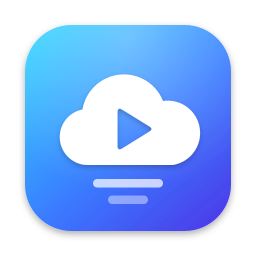
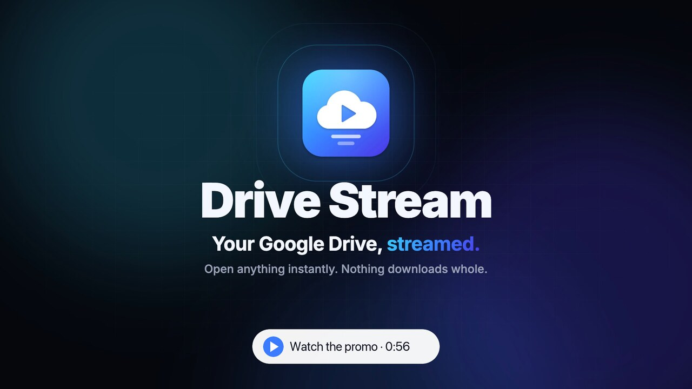
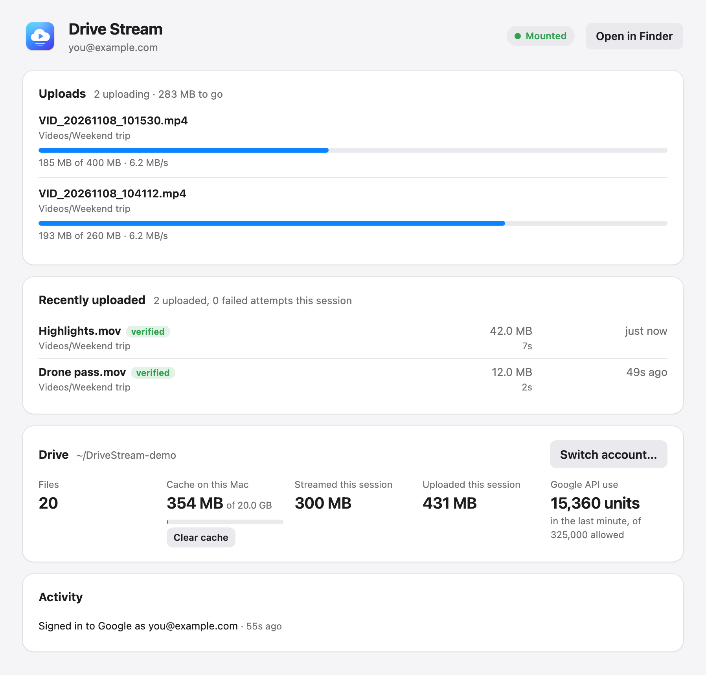
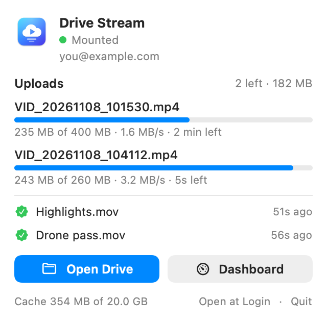

<p align="center"></p>

<h1 align="center">Drive Stream</h1>

<p align="center">
Mount your Google Drive on a Mac as a folder that <b>streams</b> files on demand.<br>
Open a 4 GB video and it starts playing right away. Nothing is downloaded whole, and nothing fills your disk.<br>
Edit 4K straight from Drive in DaVinci Resolve or Premiere, and browse your sample libraries in Ableton Live.
</p>

<p align="center">
<a href="https://github.com/bighitbiker3/drive-stream/releases/download/v0.1.0/drive-stream-promo.mp4"></a><br>
<sub>▶ <a href="https://github.com/bighitbiker3/drive-stream/releases/download/v0.1.0/drive-stream-promo.mp4">Watch the 56-second promo</a></sub>
</p>

---

## Set it up with your AI agent

Paste this into Claude Code, Codex, Cursor, or any coding agent that can run commands on your Mac:

```text
Set up Drive Stream on my Mac (https://github.com/bighitbiker3/drive-stream). It mounts my
Google Drive as a folder that streams files on demand. Follow the repo's README; in short:

1. Check that this Mac runs macOS 14 or newer. Make sure the Xcode Command Line Tools
   (`xcode-select --install`) and Rust (https://rustup.rs) are installed; install what's missing.
2. Clone the repo and run `./install.sh`. It builds the app, installs "Drive Stream.app" to
   ~/Applications, and starts a background service at login. Tell me before running it.
3. Walk me through creating my own Google OAuth client. I have to click through the Google
   Cloud Console myself, so give me one step at a time with direct links:
   create a project → enable the Google Drive API → set up the consent screen (External;
   add my Google account as a test user, or publish the app) → create an OAuth client of
   type "Desktop app".
4. Open http://127.0.0.1:7317 and have me type the client ID and secret into that page and
   click "Sign in with Google". Never ask me to paste the client secret into this chat.
5. Wait until the dashboard says "Mounted", then show me ~/DriveStream in Finder and check
   that streaming works by reading a few MB from the middle of a large file there.

If anything fails, use the README's Troubleshooting section and the log at
~/Library/Logs/DriveStream.log.
```

Prefer doing it yourself? See [Install](#install).

---

<p align="center">

&nbsp;

</p>

## Why

Google Drive for desktop shows your files in Finder, but many apps make it download a whole file before they can open it. A 4 GB clip means waiting for 4 GB, and then 4 GB of your disk is used. Drive Stream mounts your Drive differently: every read an app makes becomes a ranged download of just those bytes, with read-ahead for anything played straight through.

On one home connection, against the same 2 GB 4K clip:

| | Google Drive for desktop | Drive Stream |
|---|---|---|
| Reading straight through | 1.6 MB/s (13 Mbit/s) | **27–33 MB/s (220–260 Mbit/s)** |
| 4 MB from the middle of the file | 2.75 s | **1.3 s** |
| Jumping to a new point | — | **0.5–0.8 s** |
| Re-reading something already viewed | — | local disk speed |

ffmpeg decodes 60 Mbit/s 4K footage through the mount faster than real time, starting from any point in the file.

## Features

- **Streams, doesn't sync.** Files are fetched in 4 MB blocks as apps read them, several at a time, with read-ahead for sequential reads. Recently used blocks stay in a local cache (20 GB by default; the least recently used blocks are deleted first).
- **Your whole My Drive in Finder.** Folders, names, sizes and dates come from a local copy of your file list, so browsing is instant. Changes made elsewhere (web, phone, another computer) show up within 10–20 seconds.
- **Uploads you can trust.** Copy files in and they upload in the background once they stop changing. Every upload is checked against the MD5 checksum Google computes, and anything that doesn't match is uploaded again. Failed uploads retry with backoff.
- **Behaves like a normal folder.** Rename and move are instant on Drive (no re-upload). Deleting moves things to Drive's trash. Editors that save by writing a temp file and renaming it over the original update the same Drive file, so version history and sharing are kept. Finder's `.DS_Store` and `._*` files stay on your Mac.
- **A menu bar app and a dashboard.** See upload progress, speed and time left; recent uploads with checksum results; cache use; Google API use; and sign in to Google, all without a terminal.
- **Made for creative work.** Video editors and DAWs read media the plain way, so they stream too: cut 4K in DaVinci Resolve or Premiere Pro straight from Drive and scrub anywhere, or point Ableton Live at a sample library in Drive and preview without syncing it. See [Tips for creative apps](#tips-for-creative-apps).
- **No kernel extension, no admin password.** It runs as you and uses the NFS client built into macOS.

## Requirements

- macOS 14 (Sonoma) or newer, Apple silicon or Intel
- Xcode Command Line Tools: `xcode-select --install`
- Rust 1.85 or newer: [rustup.rs](https://rustup.rs)
- A Google account, and about 5 minutes in the Google Cloud Console to create your own OAuth client ([below](#1-create-your-google-oauth-client))
- Free disk space for the cache (20 GB by default; adjustable)

## Install

### 1. Create your Google OAuth client

Drive Stream talks to Google Drive with your own OAuth client, so you get your own API quota and nobody else's app sits between you and your files. In the [Google Cloud Console](https://console.cloud.google.com/), signed in with the Google account whose Drive you want:

1. **Create a project.** Go to [New project](https://console.cloud.google.com/projectcreate), name it something like `drive-stream`, and click **Create**. Make sure it's selected in the project picker at the top.
2. **Enable the Drive API.** Open the [Google Drive API](https://console.cloud.google.com/apis/library/drive.googleapis.com) page and click **Enable**.
3. **Set up the consent screen.** Go to [Google Auth Platform](https://console.cloud.google.com/auth/overview) and click **Get started**. Enter an app name (e.g. `Drive Stream`) and your email, choose **External** as the audience, and finish.
4. **Allow your account.** Under [Audience](https://console.cloud.google.com/auth/audience), either:
   - click **Publish app** (recommended: your sign-in then lasts until you revoke it), or
   - add your Google account under **Test users**. While the app is in *Testing*, Google ends the sign-in after 7 days and you sign in again from the dashboard.
5. **Create the client.** Under [Clients](https://console.cloud.google.com/auth/clients), click **Create client**, choose **Desktop app**, and click **Create**. Keep the **Client ID** and **Client secret** handy for step 3.

When you sign in, Google will say it "hasn't verified this app". That's expected: it's your own app. Click **Advanced → Go to Drive Stream**.

### 2. Build and install

```sh
git clone https://github.com/bighitbiker3/drive-stream.git
cd drive-stream
./install.sh
```

`install.sh` builds everything and:

- installs **Drive Stream.app** in `~/Applications` (the menu bar app, with the `drivestream` service inside it),
- creates a LaunchAgent (`~/Library/LaunchAgents/io.github.drivestream.plist`) so the service starts at login and restarts if it crashes,
- starts it, opens the menu bar app, and opens the dashboard if you're not signed in yet.

Run it again any time to update; your sign-in and cache are kept. Settings are environment variables:

| Variable | Default | |
|---|---|---|
| `MOUNTPOINT` | `~/DriveStream` | Where the drive appears |
| `CACHE_GB` | `20` | Disk the local cache may use |
| `UI_PORT` | `7317` | Dashboard port |
| `ALLOW_HOSTS` | *(none)* | Extra host names for the dashboard, comma-separated (see [Remote dashboard](#reaching-the-dashboard-from-another-device)) |
| `NO_BUILD` | | Set to install an already-built `target/Drive Stream.app` |
| `NO_OPEN` | | Set to not open the app and dashboard afterwards |

For example: `MOUNTPOINT=~/GoogleDrive CACHE_GB=50 ./install.sh`

### 3. Sign in

Open the dashboard at **http://127.0.0.1:7317**, or click the menu bar icon and choose **Sign in to Google…**:

1. Enter the client ID and secret from step 1 (first time only) and click **Sign in with Google**.
2. Approve access in the Google tab that opens.
   - **Browser on this Mac:** that's it.
   - **Browser on another device:** Google's last page won't load, because it points at `127.0.0.1` on your Mac. Copy that page's address from the address bar and paste it into the box on the dashboard.

The first time, Drive Stream downloads your file list. That's quick for most drives, but large ones take a while (about 11 minutes for 250,000 files). The dashboard shows progress. After that, startup takes about a second.

## Using it

- **Browse and open files** in `~/DriveStream` like any folder; drag it into Finder's sidebar to keep it handy. Video players, editors and `ffmpeg` read just the parts they need.
- **Upload** by copying or dragging files in. The copy finishes at local-disk speed; the upload starts once a file has gone unchanged for a few seconds and shows up in the menu bar app and the dashboard.
- **Google Docs, Sheets and Slides** appear as small `.gdoc`, `.gsheet` and `.gslides` files containing a link to the document, like in Google's own app.
- **Menu bar app:** the icon changes with the service's state: a drive with a cloud when all's well, a cloud with an up arrow while uploading, and a cloud with an exclamation mark when you need to sign in. Its panel shows uploads, recent uploads and the cache, with buttons for Finder and the dashboard. Turn on **Open at Login** there.
- **Dashboard** (http://127.0.0.1:7317) shows:
  - uploads in progress and the last 200 uploads, with checksum results
  - the cache, with a **Clear cache** button
  - Google API use against the per-minute limit
  - recent activity
  - sign-in and **Switch account…**
- **Command line:** the service binary is `~/Applications/Drive Stream.app/Contents/MacOS/drivestream`; `drivestream status` prints its live stats as JSON.

### Tips for creative apps

- **Video editors** (DaVinci Resolve, Premiere Pro and others): import media straight from the drive, with no copying needed. Playback and scrubbing stream just the parts you touch, and recently used footage stays in the cache. For heavy multi-cam timelines, create proxies or optimized media on a local disk. Some cameras tag log footage as Rec.709 inside the file, so set the input color space yourself; that's about the file, not Drive Stream.
- **Ableton Live:** add the folder to **Places** in the browser. Browsing is instant because the file list is local. The first preview of a sample fetches it (usually well under a second), and after that it's cached. Live writes small `.asd` analysis files next to samples it analyzes, and on this drive those upload to Drive like any other file. To avoid that, turn off **Create Analysis Files** in Live's Settings › File & Folder.
- **Big libraries:** a larger cache (`CACHE_GB=100 ./install.sh`) keeps more of the samples and footage you actually use on your Mac.

## Configuration

`install.sh` covers most needs. For anything else, edit the arguments in `~/Library/LaunchAgents/io.github.drivestream.plist` and re-run `./install.sh`, or run the service yourself:

```
drivestream serve [OPTIONS] <MOUNTPOINT>

  --cache-gb <GB>          Disk cache budget                                     [default: 20]
  --block-mb <MiB>         Block size: one Drive download request per block      [default: 4]
  --readahead-mb <MiB>     How far ahead of a sequential reader to fetch          [default: 32]
  --parallel <N>           Concurrent downloads (foreground and read-ahead each)  [default: 8]
  --poll-secs <S>          How often to check Drive's change feed                 [default: 10]
  --settle-secs <S>        How long a changed file must sit still before upload   [default: 3]
  --readonly               Mount read-only even if the sign-in allows writes
  --ui-port <PORT>         Dashboard port                                         [default: 7317]
  --allow-host <HOST>      Extra dashboard host name; ".example.com" allows any subdomain.
                           Repeatable. Also DRIVESTREAM_ALLOW_HOSTS (comma-separated)
  --port <PORT>            Local NFS port (0 picks a free one)                    [default: 0]
  --no-mount               Serve NFS without mounting (for testing)
  --state-dir <DIR>        Sign-in, metadata and cache   [default: ~/Library/Application Support/DriveStream]
                           Also DRIVESTREAM_STATE

drivestream auth --client <FILE>   Sign in from a terminal instead of the dashboard. FILE is the
                                   client JSON downloaded from Google Cloud, or a dotenv file with
                                   DRIVESTREAM_CLIENT_ID and DRIVESTREAM_CLIENT_SECRET
drivestream status                 Print live stats as JSON
```

Logging follows `RUST_LOG` (default `drivestream=info,nfsserve=warn`).

### Reaching the dashboard from another device

The dashboard only listens on `127.0.0.1`. To open it from your phone or another computer, put a tunnel or reverse proxy in front of it, then tell Drive Stream to accept that host name. It rejects any other host name, which protects it from DNS-rebinding attacks.

```sh
# e.g. with Tailscale: `tailscale serve --bg 7317`, then
ALLOW_HOSTS=.ts.net ./install.sh
```

**The dashboard has no login of its own.** Anyone who can reach it can see your file names and sign the service in or out. Only expose it through something that authenticates you, such as Tailscale, Cloudflare Access, or an SSH tunnel. Never expose it to the open internet.

## How it works

```
apps (Finder, QuickTime, DaVinci Resolve, ffmpeg …)
   │  ordinary file reads and writes
   ▼
macOS NFS client         mount_nfs on localhost: no kernel extension, no root
   │  NFSv3 over 127.0.0.1
   ▼
drivestream (Rust)
   ├─ metadata  every Drive file's metadata in SQLite, built once from a full listing
   │            and kept current from Drive's change feed; an in-memory folder tree
   │            is patched one folder at a time as changes arrive
   ├─ reads     4 MiB blocks, one HTTP Range request each, streamed so a read returns
   │            as soon as its bytes arrive; a memory cache in front of a disk cache
   │            that drops the least recently used blocks; parallel read-ahead for
   │            sequential readers; a seek gets priority over queued read-ahead
   ├─ writes    each change lands in a local staging copy immediately; the file uploads
   │            (resumable, 8 MiB pieces, up to 4 files at once) once it stops changing;
   │            MD5 checked against Drive's
   └─ UI        dashboard + JSON API on 127.0.0.1:7317, used by the menu bar app
   ▼
Google Drive API v3
```

A few details:

- **Why NFS?** macOS has an NFS client built in, and mounting a server on `localhost` needs no kernel extension, no system extension approval and no admin rights. Apple's File Provider (which Google's app uses) is designed around whole files, and many apps make it fetch the entire file before opening it.
- **Cache keys are content checksums**, so renaming or moving a file never throws away what's cached, and once the change feed reports an edit made elsewhere, the old content is never served again.
- **When an upload waits:** a file uploads after it has gone unchanged for 3 seconds. A file that's still growing (being copied in from a slow card, say) gets 10 seconds. A new file that's still empty gets 10 minutes, because Finder creates every destination file first and fills them one at a time. Temporary files created and deleted within that window never upload.
- **Names:** Drive allows `/` in names and several items with the same name in one folder. A `/` appears as `:` (which Finder displays as `/`), and duplicates get ` (1)`, ` (2)` like in Google's app.
- **Inode numbers are stored**, so every file keeps the same identity across restarts of the service.

## Limits and caveats

- **Only My Drive** is mounted (not Shared drives or "Shared with me").
- **Google's API limits apply.** They're per user and per Google Cloud project, as of May 2026:
  - **Requests:** 325,000 quota units per minute per user; a download request costs 200 units.
  - **Downloads:** the first 1 TB a day per project is free, with charges for more announced for later in 2026.
  - **Uploads:** 750 GB a day per account.
  The dashboard shows your API use over the last minute.
- **An app that isn't verified by Google** can be authorized by at most 100 accounts, and shows the "unverified app" warning. That's fine for personal use; sharing one OAuth client widely would need Google's verification.
- **Editing part of a large existing file** downloads it whole and re-uploads it whole, because Drive can't update part of a file.
- **Finder's "on disk" size** for a file equals its full size. That's the macOS NFS client: it ignores the server's figure. The real local usage is the cache, which the dashboard shows.
- **Huge folders in Finder's icon view** make Finder read every file to draw thumbnails. Use list view for folders with thousands of photos or videos.
- **Uploads must finish before shutdown.** When the service stops it gives pending uploads 3 tries (up to 2 minutes). Anything still unsent is kept in `~/Library/Application Support/DriveStream/staging-orphaned-*`, but isn't uploaded automatically yet.

## Troubleshooting

| Problem | Fix |
|---|---|
| "Access blocked: … has not completed the Google verification process" | Your Google account isn't allowed yet: add it as a test user, or publish the app ([step 1.4](#1-create-your-google-oauth-client)). |
| Menu bar shows "Sign-in expired" | Your Google Cloud app is in Testing mode (7-day sign-ins). Click **Sign in to Google…**, or publish the app to stop it expiring. |
| The drive isn't mounted | Check the service with `launchctl print gui/$(id -u)/io.github.drivestream \| head` and the log at `~/Library/Logs/DriveStream.log`. Re-running `./install.sh` restarts it. |
| Finder hangs on the drive after a crash | `umount -f ~/DriveStream`, then re-run `./install.sh`. |
| Dashboard won't load | Make sure nothing else uses port 7317 (`lsof -i :7317`), or install with `UI_PORT=…`. |
| Uploads keep failing | The dashboard shows the error for each file. Common causes: a full Drive, or 750 GB uploaded in the last 24 hours. Fix the cause and click **Retry now**. |
| Start completely fresh | `./uninstall.sh --purge`, then `./install.sh`. |

## Uninstall

```sh
./uninstall.sh            # remove the app and service; keep sign-in and cache
./uninstall.sh --purge    # also delete the sign-in, metadata and cache
```

Pending uploads finish and the drive unmounts first. Your files stay in Google Drive. If you turned on **Open at Login**, also remove Drive Stream under System Settings › General › Login Items.

## Privacy and security

- **Everything runs on your Mac.** Drive Stream talks only to Google's APIs (`oauth2.googleapis.com`, `www.googleapis.com`). There's no server of ours, and no telemetry.
- **Your sign-in** (Google refresh token and your OAuth client) is stored in `~/Library/Application Support/DriveStream/token.json`, readable only by you (mode 0600).
- **The dashboard** listens on `127.0.0.1` only:
  - Requests that change something must carry an `X-Drive-Stream` header, which other websites' scripts can't add, so they can't control it.
  - Requests for an unexpected host name are refused, which blocks DNS rebinding.
- **Deleting** a file moves it to Drive's trash; nothing is deleted permanently.

## Development

```
src/            the drivestream service (Rust)
  main.rs       CLI, startup, background tasks
  fs.rs         NFS filesystem: lookups, reads, writes
  cache.rs      block cache, read-ahead, ranged downloads
  meta.rs       metadata database and folder tree
  writes.rs     staging, upload scheduling, checksum checks
  drive.rs      Google Drive API client
  auth.rs       OAuth (PKCE, loopback redirect or pasted address)
  ui.rs         dashboard server and JSON API
ui/index.html   the dashboard (single file, no dependencies)
menubar/        the menu bar app (SwiftUI)
assets/         icon sources (SVG) and generated icons
tests/          a fake Google Drive and end-to-end tests
promo/          the promo video (Remotion); see promo/README.md
```

Build with `./build.sh` (produces `target/Drive Stream.app`). Set `SIGN_IDENTITY` to sign with a Developer ID, and `BUNDLE_ID` to use your own identifier.

**Tests** run against `tests/mockdrive.py`, a fake Drive API. It has realistic latency and per-connection bandwidth, and its file content can be checked byte for byte. Each script starts its own fake Drive and service on spare ports and mounts inside `target/`, so it won't touch a real installation.

```sh
tests/run_mock_suite.sh    # reads, change feed, writes, Finder-style copies, upload failures
tests/verify_ui.sh         # dashboard: sign-in flows, request guards, upload progress
tests/snapshot_menubar.sh  # render the menu bar panel to PNG
tests/screenshots.sh       # regenerate docs/*.png
# against your real Drive (read-only):
tests/verify_real.py ~/DriveStream ~/Library/Application\ Support/DriveStream "path/to/a/large/video.mov"
```

The icon is `assets/icon.svg` (and `icon-small.svg` for 16–32 px). After editing it, run `assets/build-icons.sh`, which needs `brew install librsvg`.

Issues and pull requests are welcome. Please run `tests/run_mock_suite.sh` and `tests/verify_ui.sh` before sending a change.

## License

[MIT](LICENSE)

Drive Stream is not affiliated with, endorsed by, or sponsored by Google. Google Drive is a trademark of Google LLC.
